# 第 4 讲学生工作单：降维、PCA 与 UMAP

负责人：zhang。对应原课程安排“第 3 讲b”，现独立为第 4 讲。主题：如何把复杂高维数据压缩到可理解的低维空间？

## 数据情境与初始判断

团队得到 72 份白血病样本的 7,129 个探针表达特征，希望理解 ALL 与 AML 的样本结构。同事展示了一张二维 UMAP 图，并说：“图上分得开，就证明发现了疾病机制，并可以预测新患者。”你同意吗？先写判断、信心和最想补充的一项证据。

初始判断：__图上分得开不能完全证明特征区分的程度对于疾病机制分析是有效的，需要更多验证__；信心（0–100）：__91__；需要的证据：__表达特征的维度，是否提前进行标准化，“分得开”的程度如何___。

先读 [数据说明](data/README.md)，使用 `data/leukemia/leukemia.csv`。确认一行代表什么、矩阵形状、两类样本数；排除 `sample_id`、`original_split`、`diagnosis` 三个元数据列。7,129 列是探针，不等于不同基因数。上述内容仅作数据准备，不重复第 3 讲的距离与过拟合实验。

建议课堂 45 分钟，课后完成对照与报告约 60–90 分钟。每项任务先预测、再观察、后解释；可用 Python 或 AI 辅助编程，但须保留代码、参数和实际运行结果。参考流程见 [独立讲解稿](Dimension-reduction.md)。

核心问题：降维是为了可视化，还是为了建模？PCA 和 UMAP 有什么区别？如何避免过度解释降维图？

## 任务 1：降维是为了看图，还是预测新样本？

为以下目标分别填写“需要什么输出”和“如何判断有用”：可视化；去噪；压缩特征；发现样本结构；作为后续模型输入。

画出两条流程：

1. 描述这 72 个样本：表达矩阵 → 标准化 → PCA/UMAP → 诊断着色。
2. 评估新样本预测：先划分数据 → 在训练折内拟合标准化、PCA 与分类器 → 转换并预测验证折 → 固定方案后评估测试集。

指出为什么“PCA 没用标签，所以可以在全数据上先做 PCA 再交叉验证”仍会泄露信息。可选验证：仅在原始 38 个训练样本内，用 `StratifiedKFold(3, shuffle=True, random_state=42)` 比较 `StandardScaler → 1近邻` 和 `StandardScaler → PCA(10, svd_solver='full') → 1近邻`，报告各折 balanced accuracy 及均值，不重新读取原始测试标签评分或调参。把全部拟合步骤放进 Pipeline。

**提交：**目标—输出—评价表，以及标出拟合范围的两条流程。

| 目的 | 输出 | 如何评价 |
|---|---|---|
| 可视化 | 二维或三维坐标 | 可读性、参数稳定性与解释边界 |
| 去噪 | 减少不稳定变化的表示 | 重复测量或下游验证，不是仅看图更整齐 |
| 压缩特征 | 较少坐标、近似重建 | 维数、重建误差、解释率与计算成本 |
| 发现样本结构 | 候选分组、梯度与邻域 | 稳定性、外部信息与独立数据验证 |
| 后续建模输入 | 可一致变换新样本的特征 | 无泄露的交叉验证与独立测试表现 |

流程图1和2分别如下：

即使PCA不读取诊断标签，若在交叉验证前用全体样本拟合标准化和PCA，验证折的特征分布与协方差也参与了变换方向，属于预处理信息泄露（不是标签泄露）。预测评估时应把标准化、PCA和分类器放入Pipeline，在每个训练折内拟合。

## 任务 2：PCA 保留了什么，又丢掉了什么？

使用全部 72 行、7,129 个探针，排除三个元数据列。本任务只描述当前数据。

1. 用 `StandardScaler` 按列标准化，检查变换后的列均值和总体标准差（`ddof=0`）。解释标准化与微阵列上游归一化不是同一步骤；本课不对含负值的矩阵直接取对数。
2. 对标准化矩阵做 PCA，记录 PC1、PC2 各自的 explained variance ratio、两者之和及累计解释率曲线。画 PC1 vs PC2，轴上注明解释率，拟合后再用诊断着色。
3. 提取 PC1 中绝对权重最大的 5 个探针及其带符号权重。本工作单将 `components_.T` 定义为主成分方向权重（loading）；若软件使用其他 loading 定义，须注明。解释样本的 PC1 得分如何由标准化特征加权得到。
4. 做一次仅中心化、未标准化的原尺度 PCA 作为对照。比较解释率与高权重探针，讨论大尺度/大方差特征如何影响主成分，以及标准化可能放大低变异噪声的代价。

回答：PC1 最大化的是什么方差？它是否等于“最能区分 ALL/AML 的方向”或某一个基因？主成分符号整体翻转是否改变结果？中心化后的 72 个样本为什么至多有 71 个非零主成分？

PC1最大化的是所有基因的方差，而不是“最能区分 ALL/AML 的方向”或某一个基因。主成分符号整体翻转不改变结果，中心化后72个样本至多有71个非零主成分是因为72维矩阵的秩最多为71。

**提交：**PCA 散点图、累计解释率图、5 个探针的权重表，以及一句对 PC1 的解释和一句不能据此推出的结论。

## 任务 3：UMAP 上的簇可以相信到什么程度？

继续使用任务 2 的同一标准化矩阵，不按诊断筛选探针。用 `umap-learn` 拟合二维 UMAP，基线参数为 `n_neighbors=15`、`min_dist=0.1`、`metric='euclidean'`、`random_state=42`、`n_jobs=1`；拟合后按诊断着色。

与基线作三个单因素对照：只将 `n_neighbors` 改为 5；只将 `min_dist` 改为 0.5；只将种子改为 7。并排比较 PCA 与 UMAP，并保留坐标与样本编号的对应表，以便追踪同一个样本。不能仅挑分组最清楚的一张图汇报。

填写比较表：线性/非线性；优化或保留的主要信息；坐标轴含义；能否报告方差解释率；局部邻域与全局距离的解读；参数与随机性；用于预测时如何避免泄露。

回答：哪些邻近关系在不同设置下较稳定？岛屿数量、岛屿间距离、方向和面积是否稳定？为什么 UMAP 常用于单细胞或复杂表型展示？图上分离能否证明疾病机制、真实亚型数量或新患者预测性能？本数据缺少批次字段，能否宣称已经排除批次影响？

邻近关系方面，图中一些样本群在不同设置下仍可辨认，但整体布局变化很大。例如，基线与 n_neighbors=5 的图中，局部聚集的形态和位置已不同；min_dist=0.5 时点云更分散；随机种子改为7后，图形方向和布局也明显变化。因此，这张图支持“部分局部结构可能在设置变化时仍存在”的观察，但仅凭图无法确定具体哪些样本始终互为近邻；这需要用坐标计算各样本的近邻集合及重合率。
岛屿数量、岛屿间距离、方向和面积从图上看都不宜认为稳定。不同参数下嵌入的形状和空间布局发生明显变化，且UMAP坐标轴可以旋转、翻转或重排；图上岛屿之间的距离和面积也不代表原始高维空间中的真实生物学距离或群体规模。
UMAP常用于单细胞或复杂表型展示，是因为它能将高维数据中的局部邻域关系映射到二维，便于探索候选分组、连续梯度和异常样本。它适合提出假设，但不直接检验假设。
所以，图中UMAP的视觉分离不能证明疾病机制、真实亚型数量，也不能证明对新患者有预测能力。验证机制需要额外的生物学证据，判断亚型需稳定、可重复的聚类及独立样本支持，预测能力则需无信息泄露的训练验证流程和独立测试集。
最后，本数据缺少批次字段，因此不能宣称已经排除批次影响。诊断组间的分离可能与疾病状态有关，也可能部分来自未记录的批次、样本处理或测量流程差异；当前图无法区分这些解释。

**提交：**PCA/UMAP 比较图、参数对照图，以及三条“图能支持什么／不能支持什么”的判断。

## 任务 4：给研究团队写一份结论

用“主张—证据—推理—边界”写四句话，回应“二维图分得开，就证明发现了疾病机制，并可以预测新患者”的主张。至少引用一项 PCA 解释率或 loading 结果，以及一项 UMAP 参数对照；若要把图上的模式升级为生物医学结论，提出一项额外验证。

**作业：**用自己的话分别解释：

1. PCA 第一主成分代表什么？结合本次解释率和一个探针权重说明。
2. 为什么 PCA 前通常需要考虑标准化？结合原尺度对照说明它的作用与代价。
3. UMAP 图能说明什么，不能说明什么？结合一次参数或种子对照说明。

## 最终提交

提交一份含代码与运行结果的 notebook 或分析报告，按任务编号组织，并附本讲退出卡与三道作业。记录软件版本、随机种子、输入特征、标准化方式和拟合范围。评价重点为：数据理解正确、对照可复现、用实际证据解释、承认结论边界；不以图是否“漂亮”或类别是否完全分开评分。

项目内的运行缓存、坐标表和可重新生成的图片统一保存到项目根目录 `.tmp/dimension-reduction/student-results/`；最终提交的分析报告保留在课程目录或教师指定位置。

