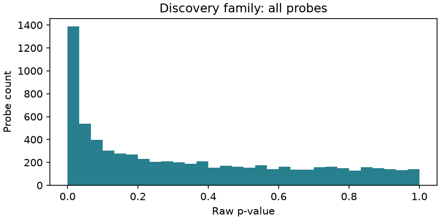

# HW06：多重检验校正实验报告

- 姓名：黄诗妍
- 学号：32320232203033
- GitHub 用户名：huangshiyannn
- 完成日期：2026-11-26

## 一、初始预测与预定分析协议

若 1,000 个变量均无真实差异，每项以 0.05 为阈值，预计平均有 50 个原始显著结果。课堂情境里的 53 个与这个预期接近，单凭数量不足以认定这些基因与疾病有关，需考虑全部检验和后续验证。若增至 5,000 项，平均假发现数升至 250，独立检验下至少出现一个假阳性的概率也更接近 1。B 中预计 δ 减半时，三种方法的检出力都会下降。

| 项目 | 运行前记录 |
|---|---|
| 研究问题 | 比较急性髓系白血病（AML）与急性淋巴细胞白血病（ALL）的平均探针表达。两组都是患者。 |
| 发现样本 | 固定使用 `original_split=train`，AML 11 份、ALL 27 份。 |
| 检验家族 | 全部 7,129 个探针，包括控制探针。排除 `sample_id`、`original_split`、`diagnosis` 三个说明字段。 |
| 单项检验 | 双侧 Welch t 检验。H₀ 为该探针在 AML 与 ALL 的总体均值相同。两种方向的差异均有意义，且 Welch 检验允许两组方差不同。 |
| 尺度和方向 | 保留处理后的微阵列强度，不取对数或额外缩放，零值和负值按原值保留。均值差统一为 AML−ALL。 |
| 筛选阈值 | 对同一组原始 p 值分别按 raw、Bonferroni 和 BH 的 p 值 ≤ 0.05 计数。 |
| 候选锁定 | 在发现部分 BH adjusted p ≤ 0.05 的探针中，按 raw p 升序排列，同值按探针名升序，保存前 10 个及发现差值。不足 10 个则全部保留。 |
| 留出判据 | 固定使用 `original_split=test`，AML 14 份、ALL 20 份。只对锁定候选做双侧 Welch 检验。候选家族内 Bonferroni adjusted p ≤ 0.05 且差值与发现同号，才算通过。 |

如果共同支持一项结论，5 个临床指标应计入 5 次检验，4 个亚组的同一终点做 4 次组内检验，组合使用则考虑全部实际比较。若试 3 个模型后只报最显著的结果，也要考虑 3 次选择机会，并预先说明模型及处理策略。按 p 值从 7,129 个探针中选前 20 个时，每个探针都有成为候选的机会，因此发现家族仍是 7,129 项。

## 二、A/B 模拟实验

2026-11-26 使用课程 Notebook 补跑。每次模拟 1,000 个独立正态变量，模拟 AML 组 11 个观测、ALL 组 27 个，组内标准差均为 1。每种情境用种子 42 重复 1,000 次，三种方法共用每次的原始 p 值。模拟已知正态且等方差，故使用双侧等方差 t 检验。

| A：全零情境 | 第一次 R | 平均 R | R 的标准差 | R 的 5%–95% 分位区间 | FWER 估计 | FDR 估计 |
|---|---:|---:|---:|---|---:|---:|
| raw | 42 | 49.944 | 6.762 | 39–61 | 100.0% | 100.0% |
| Bonferroni | 0 | 0.051 | 0.220 | 0–1 | 5.1% | 5.1% |
| BH | 0 | 0.052 | 0.227 | 0–1 | 5.1% | 5.1% |

平均 49.944 个，接近事前预测的 50 个。第一次的 42 个也落在实际分位区间内。全零时每次 R 都等于 V，有发现时 FDP 为 1，零发现时 FDP 为 0，所以长期 FDR 和 FWER 相等。平均 R 计的是个数，FWER 计的是出现至少一次假发现的频率。两种校正第一次都没有发现，但各自在 1,000 次中有 51 次出现假发现。5.1% 是有限次模拟的估计，蒙特卡洛标准误约为 0.70 个百分点。A 没有真信号，检出力分母为零，记为 N/A。

B 给前 100 个变量的模拟 AML 均值加上 δ，其余 900 个仍无差异。δ 为 1.0 和 0.5 时复用同一随机噪声。

| B：δ | 方法 | 平均 R | 平均 V | FWER 估计 | FDR 估计 | 平均检出力 |
|---|---|---:|---:|---:|---:|---:|
| 1.0 | raw | 122.523 | 44.799 | 100.0% | 36.43% | 77.724% |
| 1.0 | Bonferroni | 6.001 | 0.044 | 4.4% | 0.75% | 5.957% |
| 1.0 | BH | 30.094 | 1.445 | 75.4% | 4.61% | 28.649% |
| 0.5 | raw | 72.361 | 44.799 | 100.0% | 61.87% | 27.562% |
| 0.5 | Bonferroni | 0.270 | 0.044 | 4.4% | 3.93% | 0.226% |
| 0.5 | BH | 0.407 | 0.072 | 7.0% | 4.53% | 0.335% |

δ=1.0 时，BH 平均检出约 29 个真信号，Bonferroni 约 6 个。BH 的 FDR 约 4.61%，同时有 75.4% 的重复出现至少一个假发现，说明控制错误比例和防止任何一次错误的要求有多大差别。δ 减半后，BH 的检出力降到 0.335%。这些弱信号在模拟中确实存在，因此未达显著阈值无法证明效应为零。

## 三、C1：完整家族比较

发现家族为 7,129 项，Bonferroni 对应的 raw p 阈值为 0.05/7,129 ≈ 7.013606 × 10⁻⁶。

| 方法（各自阈值 0.05） | 发现数 | 结果支持的判断 | 证据边界 |
|---|---:|---|---|
| raw | 1,694 | 这些探针达到了单项拒绝阈值 | 无法由此给出家族错误率保证 |
| Bonferroni | 26 | 这些探针达到完整家族的严格阈值。在单项 p 值有效时，控制 FWER | 显著数量无法反映效应大小 |
| BH | 535 | 在独立或适当正依赖等条件下，以 5% 为目标控制 FDR，适合形成探索性候选列表 | 本数据未核实依赖条件，单项真假和本次 FDP 均未知 |

图中有较多 p 值集中在靠近 0 的区间。三种计数来自同一组 p 值，差异来自拒绝规则。直方图和发现数均无法直接给出真实的假发现数或检出力。

## 四、C2：先挑前 20 项再校正会怎样

| 同一探针 | raw p | 完整 7,129 项 BH | 先选前 20 项再做 BH |
|---|---:|---:|---:|
| `X52142_at` | 4.0016 × 10⁻⁶ | 0.001337 | 4.0016 × 10⁻⁶ |

这个探针在两种算法下均达阈值，但后者的 adjusted p 小了约 334 倍。因为筛选和校正用的是同一批 p 值，进入前 20 项的零假设 p 值也倾向偏小。事后把校正使用的家族大小改为 20，无法计入其余 7,109 次筛选机会。如果在看数据前就按外部依据指定 20 项，并把研究主张预先限定在这 20 项，则可按该预定家族校正，仍需满足相应方法的适用条件。

## 五、C3：候选锁定与效应证据

按第一节规则锁定 10 个候选。RUN_ID 为 `session-01`，锁定于 **11/26/2026 06:47:55**。原件位于本地 `.tmp/multiple-test/student-results/session-01/locked-candidates.csv`。正式附件为原样复制的 [locked-candidates.csv](locked-candidates.csv)，其中 `discovery_delta` 的正负表示发现方向。

选排序第一的探针作为报告对象。这一选择在运行留出检验前确定。

| 项目 | 发现部分结果 |
|---|---|
| 探针 | `U22376_cds2_s_at` |
| n（AML / ALL） | 11 / 27 |
| 均值（AML / ALL） | 702.36 / 3,863.30 |
| 均值差 AML−ALL | −3,160.93 |
| 逐项 95% Welch CI | [−3,977.85, −2,344.02] |
| 描述性 Cohen d | −1.8484 |
| raw p | 8.3887 × 10⁻⁹ |
| Bonferroni adjusted p | 5.9803 × 10⁻⁵ |
| BH adjusted p | 5.9803 × 10⁻⁵ |

负差值表示 AML 组平均表达更低，差值保留原处理后的表达尺度，fold change 衡量的是倍数变化。Cohen d 用两组的合并标准差表示差异大小。逐项区间只按单探针的 Welch 方法构造，缺少家族同时覆盖和筛选后覆盖保证。排序靠前的探针还可能因筛选而高估效应幅度。

**查看留出结果前的判断**。这个探针在发现样本中的负向差值较大，两种完整家族校正均达阈值，值得检查留出样本是否也支持负向差异。是否通过只按第一节预定判据判断。

## 六、C4：留出验证

先写下判据并锁定名单、复制正式附件、记录对首位候选的判断，随后才运行留出检验。本人此前未在课堂演示或往次作业中查看本批 `test` 留出样本的结果，本次是首次查看。

验证家族为全部 10 个锁定候选，Bonferroni adjusted p 阈值为 0.05，对应 raw p ≤ 0.005，且要求差值与发现方向一致。10 个探针方向均一致，其中 **7 个同时满足校正阈值**。其余 3 个与发现方向相同，但校正后证据未达预定标准。样本波动和检出力有限都可能造成未通过，因此无法据此断定差异为零。

| 项目 | 留出验证结果 |
|---|---|
| 探针 | `U22376_cds2_s_at` |
| n（AML / ALL） | 14 / 20 |
| 均值差 AML−ALL | −1,766.73 |
| Bonferroni adjusted p | 0.02319 |
| 方向一致 | 是，两次均为负值 |
| 满足预定验证判据 | 是 |

原先的判断依据只有发现样本。留出结果增加了一条证据：差值虽缩小，但仍为负且通过校正，因此优先保留该探针用于后续研究。两次点估计的差异本身不足以判定效应确实减弱。

> 首位探针值得进一步验证。留出样本中，AML的平均表达仍低于ALL，差值约为负一千七百六十七，校正后p值为0.0232。方向一致且通过预定阈值，支持差异在同一研究中重现。仍需外部队列复核，现有数据无法确立机制或诊断价值。

## 七、概念与方法短答

| 概念 | 定义 | 例子 | 常见误读与纠正 |
|---|---|---|---|
| p-value | 在零假设和检验模型成立时，得到当前这样或更极端的检验统计量的概率。双侧检验考虑两个方向。 | 比较某一探针的 AML 与 ALL 均值，如果双侧 p=0.03，在总体均值相等的前提下，这样或更极端的统计量出现的概率是 3%。 | “两组均值相等的概率是 3%。”p 值计算时已把均值相等作为前提，无法给出零假设的后验概率。 |
| adjusted p-value | 在指定家族与校正方法下，该项会被拒绝所需的最小整体显著性水平或 FDR 目标水平，取决于所用方法。 | 在 5 个预定临床终点中，某终点 raw p=0.009，Bonferroni adjusted p=0.045，可按家族水平 0.05 拒绝该项。 | “0.045 是重复试验失败的概率。”这个数来自校正规则，重复结果还取决于真实效应、样本量和变异。 |
| FDR | 按同一规则重复研究时，每次假发现在全部发现中所占比例的期望。零发现时这一比例记 0。 | 探索性表达筛选用 BH 设定 5% 的 FDR 目标，在适用条件下，长期平均错误发现比例不超过 5%。 | “这一次每 100 项发现至多错 5 项。”单次错误比例可能超过 5%，也可能为零。 |

- **FWER、FDP 与 FDR。** R 是全部发现数，V 是假发现数，S 是真发现数，R=V+S。FWER 是 P(V>0)，衡量至少出现一次假发现的概率。FDP=V/max(R,1) 是单次实验的已实现比例，FDR 是这个比例的期望。若两次实验分别发现 1 项和 9 项，各有 1 项错误，FDR 的样本估计为 (1+1/9)/2≈55.6%。用平均 V 除以平均 R 得到 20%，相当于汇总发现后按发现数加权，做不到每次实验等权。
- **为什么全零时平均约 50 项显著。** 令 Iᵢ 表示第 i 项的 p 值是否 ≤0.05。零假设下若 p 值连续且校准准确，则 E(Iᵢ)=0.05，由期望的线性性质得到 E(R)=1,000×0.05=50。求期望无需独立性。相关性会改变 R 的波动和至少错一次的概率。如果检验偏保守，期望也可能低于 50。
- **BH adjusted p 与 Storey q-value。** Notebook 的 `bh` 由完整家族的排序 p 值计算，对第 i 位取从 i 到 m 的 mp₍ⱼ₎/j 的最小值并截在 1。Storey 方法通常先从 p 值分布估计真零假设比例，再估计把该项纳入发现所需的最低错误发现率水平。本实验没有进行这种估计。两者都用于多项选择，单项为假的概率需要另外建立模型估计。
- **探索性组学筛选。** 如果目标是从几千项表达指标中获得一批候选，且后续还有独立验证，可以选择 BH 控制 FDR，以保留更多真信号。代价是候选里仍可能有假发现，并需要审查探针相关性对方法条件的影响。
- **确认性临床试验。** 如果预先指定三个疗效终点，任一达标都可支持疗效申报，那么一次假阳性的后果较大。我会优先控制 FWER，例如用 Bonferroni 将各项阈值设为 0.05/3，并按校正后的阈值规划样本量。严格阈值会降低单个终点的检出力。
- **校正后的下一步。** 均值差和 Cohen d 用来判断差异幅度，CI 用来判断估计有多精确。后续还需核对探针注释、批次及样本独立性，并在独立招募的队列中按预定方法检查重复性。若要说明机制，需要额外的功能证据。现有结果无法证明该表达差异导致某一白血病亚型，也无法据此确立诊断性能。

## 八、运行与 AI 使用记录

- Python 3.12.10、NumPy 2.5.4、pandas 3.0.6、SciPy 1.18.1、Matplotlib 3.11.2。pandas 为本机已有版本，高于课程 `<3` 的建议上限。数据读取、分组、结果写出及数值核对均完成。本次结果以此环境为准。
- 数据使用课程的 `resources/data/leukemia.csv`。将 CRLF 统一为 LF 后，SHA-256 为 `fadb1e27e2b55c31464432cb51117a49198e7bc44854b0a51d5592de816fa838`，与课程记录一致。
- 当前目录是单独发放的 HW06 文件夹。运行时将 Notebook 的项目定位改为从当前目录读取 `resources/`，保留公共 Notebook 原文件。计算函数、随机种子、样本划分、家族、阈值及候选规则均沿用课程设置。本报告使用本次补跑的 A/B 数值。
- AI 协助梳理材料、执行课程代码、核对数值及起草报告。已将发现家族的 BH 结果与 SciPy 实现交叉核对，并检查正式候选附件与锁定原件逐字节一致。提交前可对照 Notebook 输出复核三处：A/B 表中的 FDR 和检出力、C1 的三种发现数，以及 C4 的 7/10 与首位探针的差值方向。再打开报告里的直方图和候选名单，确认附件可正常查看。

## 九、提交前自查

- [x] 已记录预定协议、A/B 模拟和 C1–C4 结果。
- [x] 结果来自运行输出，假设案例用于讨论。
- [x] 已在留出验证前锁定候选并复制正式附件。
- [x] 已保留同一探针的效应、区间、校正结果和留出证据。
- [x] 已说明留出样本来源及结论边界。
- [x] 已补填此前是否接触留出结果的情况，并按上一节对照关键结果和附件。
- [x] 提交时仅选个人目录内的报告、图和锁定名单。

