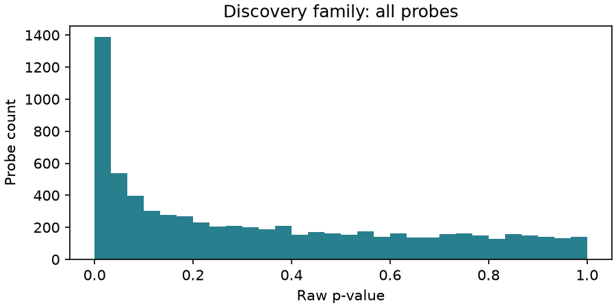

# HW06：多重检验校正实验报告

- 姓名：涂宗盛
- 学号：38720260158050
- GitHub 用户名：tzs050
- 完成日期：2026-11-25

## 一、初始预测与预定分析协议

本节在运行本次真实数据分析、查看本次留出验证结果前填写。以下预测依据理论推导，不是实际运行结果。

- 1,000 个全零变量预计产生多少个原始显著结果，为什么：在各单项检验有效、零假设均成立且显著性水平为 0.05 时，每项检验出现假阳性的概率为 0.05，因此原始显著结果数的期望为 1,000×0.05=50。这里指重复实验中的平均数量，不要求每次恰好出现 50 个。该期望由期望的线性性质得到，不要求各检验相互独立；检验间的依赖会影响发现数的波动及至少出现一次假阳性的概率。
- 53 个原始显著结果是否足以称为疾病相关基因：不足以。即使全部变量都没有真实差异，1,000 次检验也预计产生约 50 个原始显著结果，仅凭 53 个 raw p<0.05 不能判断哪些是真实差异。还需要在完整检验家族内进行多重校正，并结合效应大小、置信区间、探针注释和后续验证。53 是课堂假设案例数字，不是本次真实数据的结果；探针也不等于独立基因，统计差异不能直接证明疾病机制、因果或临床价值。
- 真实数据研究问题与组别：使用 Golub 白血病微阵列表达数据，比较 AML（急性髓系白血病）与 ALL（急性淋巴细胞白血病）的平均探针表达，筛选值得进一步验证的表达差异候选。两组均为白血病亚型，数据没有健康对照，因此不研究患者与健康人之间的差异。
- 单个探针 H0、双侧或单侧及理由：对每个探针，H0：μ_AML=μ_ALL；备择假设：μ_AML≠μ_ALL。采用双侧 Welch t 检验，因为事先没有限定表达差异方向，AML 表达高于或低于 ALL 都需要考虑；Welch 方法允许两组方差不同。检验仍依赖样本独立等假设，不能仅靠多重校正消除单项检验的局限。
- 发现部分、两组 n：仅使用 original_split=train 的 38 份表达样本进行发现分析，其中 ALL 为 27 份、AML 为 11 份。不使用 test 选择探针、确定排序或修改分析协议。
- 家族包含哪些列、大小 m；哪些列不属于家族：发现检验家族为全部 7,129 个探针表达列，包含 AFFX 控制探针，每个探针对应一个组间检验，m=7,129。sample_id 是样本编号，original_split 是样本划分字段，diagnosis 是分组字段，这三列不属于检验家族。不先按当前 p 值挑选探针再缩小校正家族。
- 阈值、差值方向、校正方法：统一使用 0.05 阈值，效应方向定义为 AML−ALL。在同一完整家族、同一组原始 p 值上，分别统计 raw p≤0.05、Bonferroni adjusted p≤0.05 和 BH adjusted p≤0.05 的发现数。Bonferroni 对应的原始 p 阈值为 0.05/7,129，约为 7.01×10⁻⁶，目标是控制 FWER；BH 目标是在相应适用条件下控制 FDR。本次 bh 列指 BH adjusted p，不是 Storey q-value，也不是单项结果为假的概率。
- 数据尺度与处理方式：保留课程 CSV 中处理后的微阵列表达尺度，不额外缩放，不直接取 log 或 log1p，不把零或负值视为缺失，也不根据结果更改样本或探针家族。差异以两组均值、AML−ALL 均值差、逐项 95% Welch 置信区间和描述性 Cohen d 表示；均值差不能称为 fold change。逐项 95% CI 不提供整个家族的同时覆盖率保证，也未进行筛选后的选择校正。
- 候选排序、数量和锁定规则：在发现部分 BH adjusted p≤0.05 的探针中，先按 raw p 升序，再按 probe 名称升序排列，选择前 10 个；不足 10 个则取全部，没有符合者则不选择候选。在查看 C4 的 test 检验结果前，保存候选名称与发现方向，生成 locked-candidates.csv，并原样复制到个人提交目录；同时记录 RUN_ID、锁定时间（含时区）、原锁定文件位置和验证前的初步判断。不得因验证失败更换候选、改变顺序或调整规则。
- 验证样本与预先规定的验证判据：仅在候选锁定后使用 original_split=test 的 34 份表达样本，其中 ALL 为 20 份、AML 为 14 份。对锁定候选进行双侧 Welch t 检验，以全部锁定候选构成验证家族，在该家族内进行 Bonferroni 校正；只有 adjusted p≤0.05 且 AML−ALL 均值差与发现部分同方向，才记为满足预定验证判据。验证家族大小为预先锁定的候选数，不能缩小为事后显著数。test 是同一研究的历史留出样本，不是新招募的外部独立队列；未通过判据不能直接证明没有差异，通过判据也不能直接证明机制、因果或临床有效性。以往课程是否接触过相关 test 结果，将在报告第六节如实说明。

## 二、A/B 模拟实验关键记录

- 来源：本次自行运行课程 Notebook 的 A、B 部分；RUN_ID 为 `session-01`。数值来自已保存的 Notebook 输出及 `.tmp/multiple-test/student-results/session-01/` 下的模拟 CSV；未重新运行模拟。A 的明细为 `simulation-all-null.csv`，B 的明细为 `simulation-signal_1.0.csv`、`simulation-signal_0.5.csv`，B 的汇总为 `signal-summary.csv`。
- 种子、重复次数、组大小、变量数与信号设置：随机种子为 42，每种情境重复 1,000 次，每次模拟 1,000 个独立正态变量，模拟 ALL 组 27 个观测、AML 组 11 个观测，噪声标准差均为 1。A 中所有变量均无真实差异（δ=0，真实信号数为 0）；B 中前 100 个变量在 AML 组分别增加 δ=1.0 或 δ=0.5，其余 900 个变量无差异。不同情境复用相同种子对应的随机噪声。模拟使用双侧等方差 t 检验，三种方法在同一组原始 p 值上分别以 0.05 为阈值；真实数据分析则按协议使用 Welch t 检验。

下表中错误率与 power 均用比例表示；平均数量保留三位小数，标准差、FDR 和 power 按需保留六位小数。

| A：全零情境 | 第一次 R | 平均 R | R 的标准差 | R 的 5%–95% 区间 | FWER 估计 | FDR 估计 |
|---|---:|---:|---:|---|---:|---:|
| raw | 42 | 49.944 | 6.761848 | 39–61 | 1.000 | 1.000 |
| Bonferroni | 0 | 0.051 | 0.220108 | 0–1 | 0.051 | 0.051 |
| BH | 0 | 0.052 | 0.226600 | 0–1 | 0.051 | 0.051 |

| B：δ | 方法 | 平均 R | 平均 V | FWER 估计 | FDR 估计 | 平均 power |
|---|---|---:|---:|---:|---:|---:|
| 1.0 | raw | 122.523 | 44.799 | 1.000 | 0.364342 | 0.777240 |
| 1.0 | Bonferroni | 6.001 | 0.044 | 0.044 | 0.007487 | 0.059570 |
| 1.0 | BH | 30.094 | 1.445 | 0.754 | 0.046077 | 0.286490 |
| 0.5 | raw | 72.361 | 44.799 | 1.000 | 0.618728 | 0.275620 |
| 0.5 | Bonferroni | 0.270 | 0.044 | 0.044 | 0.039333 | 0.002260 |
| 0.5 | BH | 0.407 | 0.072 | 0.070 | 0.045267 | 0.003350 |

- 全零时为什么 power 应记 N/A：power 定义为检出的真信号数除以真实信号总数。A 中真实信号总数为 0，该比值无定义，因此三种方法的 power 均记为 N/A，不能填成 0。全零情境下所有发现都是假发现；有发现时 FDP=1，无发现时 FDP=0，所以 FDR 与 FWER 相等。
- 一次未发现假阳性，是否代表方法永远不出错：不能。A 的第一次运行中，Bonferroni 与 BH 都没有发现，但 1,000 次重复中两者各有 51 次至少出现一个假发现，FWER 估计均为 0.051。一次结果不能代表长期错误率；0.051 是有限次模拟的估计，不表示理论控制目标变成 0.051。其蒙特卡洛标准误约为 0.00696，与目标 0.05 的微小差异可由模拟波动解释。raw 的第一次发现数为 42，而平均为 49.944，也说明理论期望约 50 不要求每次都恰好为 50。
- 方法比较反映了什么错误控制与漏检取舍；引用一项表中证据：δ=1.0 时，raw 的平均 power 最高（0.777240），但平均假发现数为 44.799、FDR 为 0.364342，缺少多重校正带来了较多错误发现。Bonferroni 的 FWER 为 0.044、平均假发现数仅为 0.044，但平均 power 降至 0.059570。BH 的 FDR 为 0.046077、平均 power 为 0.286490，在控制错误发现比例的同时比 Bonferroni 检出更多真信号；其 FWER 仍达 0.754，说明控制 FDR 不等于控制至少出现一次假发现的概率。对于错误推荐代价较高的确认性研究，可优先考虑 FWER 控制；探索性候选筛选可考虑 FDR 控制，并安排后续验证。FDR 按每次 FDP 的平均估计，不用平均 V/平均 R 代替。
- 弱信号未显著能否解释为没有真实差异：不能。B 的两个情境都预先设置了 100 个真信号，但 δ 从 1.0 减弱至 0.5 后，BH 的平均 power 从 0.286490 降至 0.003350，Bonferroni 从 0.059570 降至 0.002260。弱信号下即使存在真实差异，也会因效应较小、样本有限和校正阈值严格而大量漏检。未显著表示当前数据和规则下证据不足，不能据此断言真实效应为零。

## 三、C1：完整家族比较

- C0 数据核对：CSV 为 72 行、7,132 列，其中包含 7,129 个探针列和 3 个说明字段。train 中 ALL 27 份、AML 11 份；test 中 ALL 20 份、AML 14 份，与预定协议一致。Notebook 统一 CRLF/LF 换行后的 SHA-256 校验通过，与课程数据快照一致。本节仅对 train 进行发现检验。
- 家族 m：7,129，包含全部探针，不先按 p 值筛选。
- Bonferroni 对应的原始 p 阈值：0.05/7,129=7.013606396409034×10⁻⁶，约为 0.0000070136064。
- 结果来源：本次 `session-01` 的 C1 输出及 `discovery.csv`。逐行核对 CSV 的发现数与 Notebook 输出一致；Notebook 中 BH 实现与 SciPy 的 BH 校正结果一致性检查也已通过。

| 方法，阈值均为 0.05 | 发现数 | 能支持什么 | 尚不能说明什么 |
|---|---:|---|---|
| raw | 1,694 | 有 1,694 个探针达到未进行多重校正的单项显著性阈值，可作为初步差异线索。 | 未控制完整家族的 FWER 或 FDR，不能把这些探针全部认定为真实差异，更不能直接称为疾病相关基因。 |
| Bonferroni | 26 | 有 26 个探针在完整家族 Bonferroni 校正后显著；在单项 p 值有效的前提下，该规则控制家族至少出现一次假发现的概率不超过 0.05。 | 不保证本次 26 个发现全部真实，也不表明其效应足够大或具有机制、因果和临床意义；其余未显著探针不等于没有差异。 |
| BH | 535 | 有 535 个探针达到完整家族 BH 校正阈值，可按预定规则进一步筛选候选；在独立或适当正依赖等条件下，该规则控制长期 FDR 不超过 0.05。 | 不保证本次错误发现比例不超过 5%，也不能解释为每个发现有 95% 的概率为真。本数据未验证 BH 所需依赖条件，仍需效应证据和后续验证。 |

原始 p 值直方图（从 C1 输出原样复制到个人 figures 目录）：

图中原始 p 值在接近 0 的区域明显集中，而其余区间仍有较多探针。这说明数据中存在较多小 p 值的差异线索，但仅凭直方图不能判断每个探针是否有真实差异，也不能确定假发现数或真实信号数。

- 三种数量不同是否意味着有人算错；真实数据能否数出真正假阳性：不意味着算错。三种方法使用同一批原始 p 值和完整家族，但错误控制目标及判定阈值不同，因此本次得到 raw 1,694、BH 535、Bonferroni 26 的不同发现数。Bonferroni 的严格阈值减少假发现风险，也可能漏掉真实差异；BH 在相应条件下控制错误发现比例，允许更多探索性候选。真实数据没有逐探针的已知真值，因此不能直接数出 V、计算实际 FDP 或真实 power，也不能用发现数之差当作假阳性数量。统计显著仍需结合效应、CI 和锁定后的验证证据解释。

## 四、C2：错误筛选流程审阅

选择 `U22376_cds2_s_at`，依据本次 C2 的 `selection-bias.csv` 对照同一探针：

| 探针 | raw p | 完整家族 BH | 先选前 20 再校正的 BH |
|---|---:|---:|---:|
| U22376_cds2_s_at | 8.3887146203×10⁻⁹ | 5.9803146528×10⁻⁵ | 1.6777429241×10⁻⁷ |

- 为什么按当前 p 值筛前 20 后只校正这 20 个，不能支持原家族的错误控制：这 20 个探针是从全部 7,129 个检验中按当前 p 值挑出的，选择本身已经利用了完整家族的搜索机会。只对选中的 20 个校正，忽略了其余检验及按显著性筛选带来的选择偏倚，不能沿用原家族的错误控制保证。本例同一探针的 raw p 不变，但错误流程的 BH adjusted p 约为 1.68×10⁻⁷，明显小于完整家族的 5.98×10⁻⁵；调整值变小是家族和选择流程改变的结果，不代表证据本身增强。该探针在两种流程下均达到 0.05，不能仅凭显著与否相同就认为错误流程有效；`WRONG_` 列只用于审阅，不作为正式发现证据。
- 如果 20 个探针在看数据前已由外部依据指定，情况有什么不同：若这 20 个探针在查看本次数据和结果前，已由独立的外部研究或预定科学问题明确指定，且没有根据本次 p 值筛选或更换，就可以针对这个预定的 20 项家族进行校正，并在检验有效及方法适用条件下解释其错误控制。相应主张应限定于该预定家族；若还进行了其他终点、亚组或模型搜索，也应说明相关检验机会，不能用事后挑选伪装成预先指定。

## 五、C3：候选锁定与效应证据

请先完成本节并保存名单，再运行 C4。

- 候选数：10。依据发现部分 BH adjusted p≤0.05 的探针，按 raw p 升序、probe 名称升序取前 10 个；名单与该预定规则一致，其中 9 个发现均值差为负、1 个为正。
- RUN_ID：`session-01`。
- 锁定时间（含时区）：2026-11-25 18:14:31（Asia/Shanghai，UTC+08:00）。时间依据原锁定文件的创建及最后写入时间换算，两者一致；这是文件时间记录，Notebook 本身未输出独立锁定时间戳。本次 C3 输出显示“保留原锁定名单”，未覆盖原名单。
- 原锁定文件位置：`.tmp/multiple-test/student-results/session-01/locked-candidates.csv`。
- 正式附件：[locked-candidates.csv](locked-candidates.csv)，从 C3 原文件按字节复制，未编辑候选、顺序或发现差值；副本与原文件的 SHA-256 一致。
- 查看 C4 前的初步判断：仅依据 train 的发现证据，`U22376_cds2_s_at` 在 AML 中的平均表达低于 ALL，均值差的逐项 95% CI 不包含 0，完整家族 Bonferroni 与 BH 校正后均显著，值得按预定规则进一步验证。但这是从大量探针中筛选出的结果，发现效应可能被高估，不能直接视为稳定标志物。下一步仅检验锁定候选，要求 test 中候选家族 Bonferroni adjusted p≤0.05 且效应方向与发现部分一致；在查看验证结果前不判断其是否通过验证。

选择一个锁定候选：

| 项目 | 发现部分结果 |
|---|---|
| 探针名 | U22376_cds2_s_at |
| n_AML / n_ALL | 11 / 27 |
| mean_AML / mean_ALL | 702.363636 / 3863.296296 |
| 均值差 AML−ALL | −3160.932660 |
| 逐项 95% CI | [−3977.848573, −2344.016747]（Welch 均值差区间） |
| 描述性 Cohen d | −1.848424 |
| raw p | 8.3887146203×10⁻⁹ |
| Bonferroni adjusted p | 5.9803146528×10⁻⁵（发现家族 m=7,129） |
| BH adjusted p | 5.9803146528×10⁻⁵（发现家族 m=7,129） |

- 均值差正负的含义，为什么不能称为 fold change：差值统一定义为 AML−ALL，正值表示 AML 平均表达较高，负值表示 AML 平均表达较低。本候选的差值约为 −3160.93，表示 AML 组均值比 ALL 组低约 3160.93 个原表达尺度单位。均值差是相减，fold change 是比值，二者含义不同；本数据为处理后的微阵列表达值，且整体含零或负值，不能把该均值差直接解释为倍数变化。
- 逐项 CI 是否提供整个家族或筛选后的覆盖率保证：不能。这里的区间是单个探针的逐项 95% Welch CI，在相应模型假设下描述该估计的不确定性；它不是 7,129 个探针的同时置信区间，也未对先按 p 值选择候选的过程作选择校正。即使区间不含 0，也不能据此保证整个家族或筛选后候选的联合覆盖率，仍需结合完整家族校正和锁定后的留出验证。

## 六、C4：留出验证

- 是否先锁定再查看 test；以前课程是否接触过相关 test 结果：本次按 C3→C4 的顺序完成，候选名单于 2026-11-25 18:14:31（UTC+08:00）保存，C4 的 replication.csv 最后写入时间为同日 18:17:14；此前填写的初步判断仅依据发现部分证据，正式名单副本与原文件一致。文件时间为顺序的辅助记录，不能单独证明全部操作历史。以前的 HW03 报告已记录相同 20 份 ALL、14 份 AML 测试样本的分类结果，因此本研究的 test 样本和部分结果并非首次接触。现有记录不能确认以前是否查看过本次这些探针的逐项差异检验结果，故不声称这是完全未接触结果的盲验证；本次未据 C4 结果修改候选或验证判据。
- 验证家族大小、校正方法与阈值：10 个锁定候选，每个在 test 中作双侧 Welch t 检验，在全部 10 个候选内进行 Bonferroni 校正，adjusted p≤0.05 且 AML−ALL 差值与发现方向相同才通过。对应原始 p 阈值为 0.05/10=0.005。
- 同时满足校正显著和同方向的候选数：7/10；10 个候选方向全部一致。未通过的 L13278_at、U09087_s_at、X74262_at，其 Bonferroni adjusted p 分别为 0.107479、0.390191、0.260377，均未达到 0.05。结果依据 session-01/replication.csv 核对。

对第五节同一候选 `U22376_cds2_s_at` 补充：

| 项目 | 留出验证结果 |
|---|---|
| n_AML / n_ALL | 14 / 20 |
| 均值差 AML−ALL | −1766.728571 |
| Bonferroni adjusted p | 0.0231860378（验证家族 m=10） |
| 与发现方向是否一致 | 是，发现与验证差值均为负，即 AML 平均表达较低 |
| 是否满足预定验证判据 | 是，Bonferroni adjusted p≤0.05 且方向一致 |

补充效应证据：验证部分 mean_AML=1361.571429、mean_ALL=3128.300000，逐项 95% Welch CI 为 [−2850.721458, −682.735685]，raw p=0.0023186038。

- 未满足验证判据，是否能证明没有差异：不能。未通过表示当前样本及预定错误控制标准下证据不足，不代表真实效应为零。特别是本次 3 个未通过候选方向仍与发现部分一致，只是未达到候选家族 Bonferroni 阈值；不能因此替换候选，或改用未预定的 BH 结果宣布验证成功。
- 哪项证据改变了初始判断：验证中 7/10 个候选满足预定判据，加强了部分发现具有重复性的判断；但不是全部候选均通过。所选探针的验证差值为 −1766.73，小于发现阶段 −3160.93 的绝对值，说明发现效应大小不能原样外推。这种差异可能来自抽样波动、样本构成或筛选偏倚，不能仅凭两个估计确定原因。对该探针的判断由“值得验证的差异线索”更新为“在同一研究留出样本中获得支持的候选”，仍需外部独立验证。
- 用“主张—证据—推理—边界”写一段 80–120 字结论：该探针值得进一步验证。留出样本中均值差约为负1767，校正后p约0.023，与发现方向一致，支持差异的重复性。但其效应较发现阶段减弱，且样本来自同一研究、既往已有接触，不能据此证明因果或临床价值，仍需外部独立验证。

## 七、概念与方法短答

| 概念 | 用自己的话定义 | 一个组学/临床例子 | 一个错误解释及纠正 |
|---|---|---|---|
| p-value | 在零假设及检验模型成立时，得到当前或更极端检验统计量的概率，衡量数据与该零假设的相容程度。 | 本次探针 U22376_cds2_s_at 在发现部分双侧 Welch 检验的 raw p 约为 8.39×10⁻⁹，针对的是 AML 与 ALL 总体平均表达相等这一假设。 | 错误：p=0.03 表示零假设有 3% 的概率为真。纠正：p 是在假定零假设成立时计算的数据尾部概率，不是零假设本身的概率。 |
| adjusted p-value | 按指定检验家族和多重校正方法调整后，用于与统一显著性水平比较的数值；解释取决于家族和方法。 | 该探针在 7,129 项发现家族中，Bonferroni adjusted p 约为 5.98×10⁻⁵；同一 raw p 若事后只按 20 项校正，会得到不同数值，但不能据此获得原家族的控制保证。 | 错误：校正后的 p 是结果为假的概率，或不受家族定义影响。纠正：它是与指定错误控制规则相对应的判定量，必须注明方法和家族，并非单项真值概率。 |
| FDR | 重复执行整个分析流程时，错误发现比例 FDP 的期望；没有发现的重复中 FDP 记为 0。 | B 中 δ=1.0 时，BH 的 FDR 估计为 0.046077，是 1,000 次实验各次 FDP 的平均。 | 错误：FDR≤0.05 保证这次不超过 5% 的发现为假，或每项有 95% 的概率为真。纠正：这是对重复分析中比例期望的控制，不保证本次比例，也不提供单项真假概率。 |

- FWER、FDP、FDR 的区别；R、V、S 分别是什么：R 是全部宣布的发现数，V 是其中假发现数，S 是其中真发现数，R=V+S。FWER=P(V>0)，关注整个家族至少出现一个假发现的概率；FDP=V/max(R,1)，描述一次分析中发现有多少比例为假；FDR=E[FDP]，是重复分析中该比例的期望。A 的全零情境中，只要有发现就全部是假发现，故 FDR=FWER；B 中两者可以明显不同。
- 为什么 FDR 应平均每次 FDP，不能直接用平均 V/平均 R：FDR 的定义是 E[V/max(R,1)]，期望的比值通常不等于比值的期望。例：两次分析分别为 (V,R)=(1,1) 和 (0,9)，平均 FDP=(1+0)/2=0.5，但平均 V/平均 R=0.5/5=0.1。后者相当于按各次发现数加权汇总，不能替代每次分析等权的 FDP 平均；R=0 时也需明确按定义记 FDP=0。
- 1,000 次全零检验为何平均约 50 个原始显著结果；该期望是否要求独立：在有效、连续且精确校准的零假设 p 值下，以 0.05 为单项阈值，每个检验假阳性概率为 0.05，故期望数为 1,000×0.05=50。本次 A 的平均为 49.944，与该期望接近。期望求和不要求检验独立；依赖结构会影响数量波动和 FWER。如果单项检验保守，则期望可小于 50；若检验无效，不能套用这一计算。这里的 1,000 项检验与模拟重复 1,000 次是两个不同层次。
- BH adjusted p 与 Storey q-value 的区别；为何不能解释为单项真假概率：BH adjusted p 通过完整家族中 p 值的排序及单调调整得到，用于 BH 拒绝规则，不估计零假设比例 π₀。Storey q-value 通常结合 π₀ 的估计，描述将某项纳入发现集合所需的最小估计 FDR 水平，其估计方式和假设与 BH 不同。本次仅计算 BH adjusted p，没有自动计算 Storey q-value。二者都与发现集合的错误控制有关，不是某个零假设为真或某个发现为假的后验概率。
- 探索性组学筛选例子、选择的错误控制目标与取舍：同时比较数千个表达探针，目标是为后续实验产生候选，可在有效检验及适用依赖条件下使用 BH 控制 FDR。相较严格控制 FWER，通常能保留更多真信号，但容许集合中出现一定错误发现，需预留验证资源。本次 B 的 δ=1.0 情境中，BH 的 power 为 0.286490，高于 Bonferroni 的 0.059570，但 BH 的 FWER 为 0.754，说明不能把探索性候选直接当作确认性结论。
- 确认性临床终点例子、选择的错误控制目标与取舍：假设一项确认性试验预先规定 3 个共同考虑的疗效终点，任一错误疗效主张都可能影响临床决策，可以将这 3 个终点定义为家族，用 Bonferroni 将总体 α=0.05 分配为每项约 0.0167，控制 FWER。代价是阈值更严格、可能漏掉真实效应，需要在设计阶段考虑样本量和终点优先级。这是方法选择的教学例子，具体试验还需依预定方案处理终点关系及其他检验机会。
- 为什么校正后仍需效应、CI、生物学机制与独立验证：校正处理多次检验带来的错误风险，不能描述差异有多大或是否有实际意义；效应大小补充幅度和方向，CI 描述估计精度，但本次 CI 仅为逐项区间。生物学实验用于检验机制假说，外部独立队列用于检查不同样本或中心中的重复性。筛选偏倚、批次、混杂、探针相关和样本独立性问题不会因多重校正自动消失。
- 多重校正不能自动证明的一条结论：“某探针在 AML 与 ALL 间经 BH 校正后显著，因此它对应的基因导致白血病并可用于治疗。”校正后的表达差异不能证明因果、机制或临床有效性，且探针与基因的对应关系还需注释核查。
- 可选手算：未选择用手算替代方法例子；已分别给出探索性筛选和确认性临床终点的例子。

## 八、运行与 AI 使用记录

- Python、NumPy、pandas、SciPy 版本：Python 3.14.7、NumPy 2.5.4、pandas 3.0.6、SciPy 1.18.1，依据 session-01/versions.json 和 Notebook 环境输出。
- 数据文件与哈希核对情况：使用 assignments/hw06/resources/data/leukemia.csv。将 CRLF 统一为 LF 后，SHA-256 为 `fadb1e27e2b55c31464432cb51117a49198e7bc44854b0a51d5592de816fa838`，与课程快照一致；C0 断言通过，并再次按相同换行规则核对。数据为 72×7,132，探针 7,129 个，分组与协议一致。正式 locked-candidates.csv 与 C3 原文件哈希一致。
- 软件/参数是否修改；如修改，说明理由与影响：当前 Notebook 的 10 个代码单元与 Git HEAD 中课程模板逐项比较无差异，使用默认 RUN_ID=session-01、种子 42、每情境 1,000 次重复及预定分析参数。实际环境未完全符合 requirements.txt：pandas 要求 >=2.2,<3，实际为 3.0.6；其余上述版本在相应要求范围内。本次执行使用该环境，未为挑选结果更换参数；读取、分组和结果汇总已与 CSV 核对，BH 实现与 SciPy 比较通过。
- 与课堂记录不同的结果及排查说明（如有）：无已记录差异；结果与本次 Notebook 输出及 .tmp 中的 CSV 相互核对一致。
- AI 是否参与、参与环节，以及自己的核查方式：使用了 AI 辅助解释作业要求、导入 notebook 运行结果整理报告文字；本人核查导入数据是否有误。

## 九、提交前自查

- [√] 协议、A/B 关键记录与 C1–C4 已完成；
- [√] 结果表来自实际运行，未填入情境数字作为答案；
- [√] 本次候选在 C4 前锁定，正式名单副本与原件一致；既往接触 test 的情况已披露；
- [√] 报告保留了一个候选的效应、CI、校正结果和验证证据；
- [√] 已说明 test 非外部独立验证，以及统计结论的边界；
- [√] 个人提交目录仅包含正式报告、图与名单，未纳入批量中间文件；

