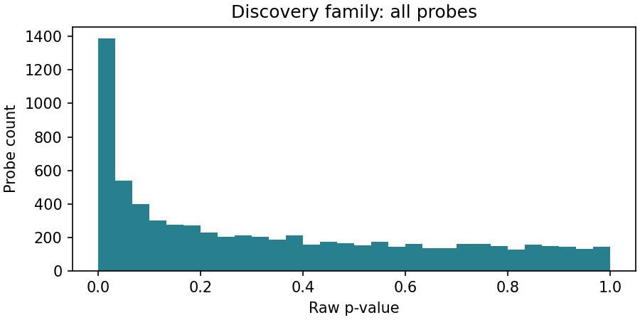

# HW06：多重检验校正实验报告

- 姓名：史英琦
- 学号：38720260158053
- GitHub 用户名：cp666syq
- 完成日期：2026-11-24

> 说明：本报告的实验数值来自我按 A→B→C 顺序实际运行课程 Notebook 后保存的 `session-01` 结果；课堂假设情境中的数字没有被当作真实实验结果。

## 一、初始预测与预定分析协议

本节应在分析真实数据、查看验证结果前填写。

- 1,000 个全零变量预计产生多少个原始显著结果，为什么：我预计平均约有 50 个。每个真实零假设在单项阈值 0.05 下有约 5% 的概率被错误拒绝，因此期望假阳性数为 1,000×0.05=50。这是重复实验中的期望数量，不要求某一次实验恰好出现 50 个。
- 53 个原始显著结果是否足以称为疾病相关基因：不足以。这个结论忽略了 1,000 次检验带来的多重比较问题，也没有报告效应大小、置信区间、错误控制方法、样本与设计、探针注释、混杂因素及独立验证证据。探针也不能直接等同于独立基因。
- 真实数据研究问题与组别：我比较 Golub 白血病数据中 AML 与 ALL 两种亚型的平均探针表达，问题是哪些表达差异值得进入后续验证。数据没有健康对照，因此不能回答患者与健康人之间的差异。
- 单个探针 H0、双侧或单侧及理由：对每个探针，H0 为 AML 与 ALL 的总体平均表达相等；使用双侧 Welch t 检验。虽然某些探针可能有预期方向，但本次对完整家族没有统一且充分的单侧先验，所以允许任一方向的差异。
- 发现部分、两组 n：`original_split=train`；ALL n=27，AML n=11。
- 家族包含哪些列、大小 m；哪些列不属于家族：家族包含全部 7,129 个表达探针，每列进行一次检验，m=7,129；`sample_id`、`original_split` 和 `diagnosis` 是说明/分组字段，不属于检验家族。控制探针仍按固定教学协议保留在家族中。
- 阈值、差值方向、校正方法：统一阈值为 0.05；效应方向定义为 AML−ALL；在同一组原始 p 值上比较 raw p、Bonferroni adjusted p 和 BH adjusted p。
- 数据尺度与处理方式：保留课程 CSV 中处理后的原表达尺度，不再取 log/log1p，不把零或负值当作缺失，也不额外缩放。均值差只能解释为原尺度差值，不能写成 fold change。
- 候选排序、数量和锁定规则：在发现部分 BH adjusted p≤0.05 的探针中，先按 raw p 升序，再按 probe 名升序，取前 10 个；不足 10 个则全部保留。在查看 test 结果前保存探针名和发现方向，不因验证结果更换候选。
- 验证样本与预先规定的验证判据：使用 `original_split=test`，其中 ALL n=20、AML n=14。只检验已锁定候选；在候选家族内 Bonferroni adjusted p≤0.05 且验证差值与发现差值方向相同，才记为满足预定验证判据。test 是同一研究的历史留出样本，不是外部独立队列。

## 二、A/B 模拟实验关键记录

- 来源：自己补跑；实际运行日期：2026-11-24。
- 种子、重复次数、组大小、变量数与信号设置：种子 42；每种情境重复 1,000 次；ALL n=27、AML n=11；m=1,000。A 中所有变量均无真实差异。B 中前 100 个变量为真信号，其余 900 个为零效应，分别比较 δ=1.0 和 δ=0.5，噪声标准差为 1，并在两个 δ 设置间复用同一随机噪声。

| A：全零情境 | 第一次 R | 平均 R | R 的标准差 | R 的 5%–95% 区间 | FWER 估计 | FDR 估计 |
|---|---:|---:|---:|---|---:|---:|
| raw | 42 | 49.944 | 6.762 | 39–61 | 1.000 | 1.000 |
| Bonferroni | 0 | 0.051 | 0.220 | 0–1 | 0.051 | 0.051 |
| BH | 0 | 0.052 | 0.227 | 0–1 | 0.051 | 0.051 |

| B：δ | 方法 | 平均 R | 平均 V | FWER 估计 | FDR 估计 | 平均 power |
|---|---|---:|---:|---:|---:|---:|
| 1.0 | raw | 122.523 | 44.799 | 1.000 | 0.364 | 0.777 |
| 1.0 | Bonferroni | 6.001 | 0.044 | 0.044 | 0.007 | 0.060 |
| 1.0 | BH | 30.094 | 1.445 | 0.754 | 0.046 | 0.286 |
| 0.5 | raw | 72.361 | 44.799 | 1.000 | 0.619 | 0.276 |
| 0.5 | Bonferroni | 0.270 | 0.044 | 0.044 | 0.039 | 0.002 |
| 0.5 | BH | 0.407 | 0.072 | 0.070 | 0.045 | 0.003 |

- 全零时为什么 power 应记 N/A：power 的分母是真实信号数，而 A 中真实信号数为 0，因此 S/0 没有定义。把它写成 0 会混淆“没有可检出的真信号”和“方法未检出已存在的真信号”。
- 一次未发现假阳性，是否代表方法永远不出错：不能。一次结果只是随机序列中的一个实现；长期错误率必须通过重复实验中 V>0 的比例或 FDP 的平均来估计。一次 R=0 不能把非零的长期风险降为零。
- 方法比较反映了什么错误控制与漏检取舍；引用一项表中证据：δ=1.0 时，Bonferroni 的 FWER 为 0.044、平均 power 仅 0.060；BH 的 FDR 为 0.046、平均 power 为 0.286。这个对照说明，严格控制“至少一次假发现”会明显牺牲检出力，而 BH 通过控制发现集合的平均错误比例保留了更多真信号。
- 弱信号未显著能否解释为没有真实差异：不能。B 中前 100 个变量的真值由模拟设定明确为非零；若 δ=0.5 时某些方法的 power 较低，它直接说明真实信号可能因样本量、效应较小和多重校正而未达到显著，未显著不等于效应不存在。

## 三、C1：完整家族比较

- 家族 m：7,129。
- Bonferroni 对应的原始 p 阈值：0.05/7,129≈7.014×10⁻⁶（运行时以 Notebook 输出的完整精度为准）。

| 方法，阈值均为 0.05 | 发现数 | 能支持什么 | 尚不能说明什么 |
|---|---:|---|---|
| raw | 1,694 | 表明在不校正多重检验时，有这些探针的单项数据与零均值差不相容 | 不能控制完整家族的 FWER/FDR，也不能把每个结果称为真实疾病基因 |
| Bonferroni | 26 | 在规定模型和完整家族下，以较保守方式控制 FWER 后仍有这些发现 | 不能证明机制、因果、临床价值或外部可重复性 |
| BH | 535 | 在 BH 条件及完整家族下控制长期 FDR 目标后，得到探索性候选集合 | 不能保证每个候选为真，也不能把 adjusted p 当作单项为假的概率 |

原始 p 值直方图（将文件保存到个人 figures 目录）：

- 三种数量不同是否意味着有人算错；真实数据能否数出真正假阳性：不意味着算错。三种方法对同一组原始 p 值施加不同错误控制目标和阈值，因此发现数本来就可能不同。真实数据中每个探针的真值未知，无法直接把发现分成 V 和 S，也不能计算真实 power；只能在模拟中因真值已知而计算这些量。

## 四、C2：错误筛选流程审阅

任选一个相同探针对照：

| 探针 | raw p | 完整家族 BH | 先选前 20 再校正的 BH |
|---|---:|---:|---:|
| `U22376_cds2_s_at` | 8.389×10⁻⁹ | 5.980×10⁻⁵ | 1.678×10⁻⁷ |

- 为什么按当前 p 值筛前 20 后只校正这 20 个，不能支持原家族的错误控制：这 20 个是根据同一批数据中的最小 p 值事后挑出的，筛选机会来自全部 7,129 个探针。把校正分母缩成 20 会忽略先从 7,129 项中择优的过程，使 adjusted p 过于乐观，不能声称控制了原完整家族的 FWER 或 FDR。
- 如果 20 个探针在看数据前已由外部依据指定，情况有什么不同：若它们在接触当前数据前依据独立文献、机制或预注册方案确定，研究问题的检验家族可以预先定义为这 20 个，此时只在这 20 项中校正有合理依据。但需要透明说明外部选择规则，且不能同时暗中浏览其余探针再只报告这 20 个。

## 五、C3：候选锁定与效应证据

请先完成本节并保存名单，再运行 C4。

- 候选数：10。
- RUN_ID：`session-01`。
- 锁定时间（含时区）：2026-11-24 17:40:00 CST（UTC+8）。
- 原锁定文件位置：`class6/.tmp/multiple-test/student-results/session-01/locked-candidates.csv`。
- 正式附件：`locked-candidates.csv`（从 C3 原样复制，不编辑）：已原样复制到本报告同目录。
- 查看 C4 前的初步判断：我把这些探针视为在发现样本中统计证据较强、值得进入预定留出验证的候选，而不是已被证明的生物标志物。发现效应可能受赢家诅咒和筛选偏倚影响，是否稳定必须看锁定后的 test 结果。

选择一个锁定候选：

| 项目 | 发现部分结果 |
|---|---|
| 探针名 | `U22376_cds2_s_at` |
| n_AML / n_ALL | 11 / 27 |
| mean_AML / mean_ALL | 702.364 / 3863.296 |
| 均值差 AML−ALL | −3160.933 |
| 逐项 95% CI | [−3977.849, −2344.017] |
| 描述性 Cohen d | −1.848 |
| raw p | 8.389×10⁻⁹ |
| Bonferroni adjusted p | 5.980×10⁻⁵ |
| BH adjusted p | 5.980×10⁻⁵ |

- 均值差正负的含义，为什么不能称为 fold change：正值表示该探针在 AML 组的平均表达高于 ALL，负值表示低于 ALL。数据保留的是包含负数的处理后表达尺度，均值差是加法差值；没有在可作比值解释的原始正值尺度上计算，因此不能称为表达倍数变化。
- 逐项 CI 是否提供整个家族或筛选后的覆盖率保证：否。该区间是单个 Welch 均值差的逐项 95% CI，没有对 7,129 个区间的同时覆盖率作校正，也没有校正从显著结果中选候选的过程。筛选后效应和区间可能偏乐观。

## 六、C4：留出验证

- 是否先锁定再查看 test；以前课程是否接触过相关 test 结果：本次作业中，我先生成并保存锁定名单，再运行 C4。此前课程是否接触过相同 test 结果没有单独记录，因此我不把本次过程表述为严格盲法。
- 验证家族大小、校正方法与阈值：10；在候选家族内使用 Bonferroni adjusted p≤0.05，并要求效应方向与发现部分一致。
- 同时满足校正显著和同方向的候选数：7。

对第五节同一候选补充：

| 项目 | 留出验证结果 |
|---|---|
| n_AML / n_ALL | 14 / 20 |
| 均值差 AML−ALL | −1766.729 |
| Bonferroni adjusted p | 0.02319 |
| 与发现方向是否一致 | 是，发现与验证均为负方向 |
| 是否满足预定验证判据 | 是 |

- 未满足验证判据，是否能证明没有差异：不能。未通过可能源于真实效应较弱、留出样本量有限、异质性、噪声或发现效应高估；它表示当前留出证据不足以满足预定标准，而不是证明总体差异严格为零。应同时查看效应方向、大小和区间。
- 哪项证据改变了初始判断：留出样本中差值仍为负，且候选家族 Bonferroni adjusted p=0.02319，因此该候选通过预定验证标准；但效应绝对值由发现阶段的 3160.933 降至 1766.729，提示发现阶段的幅度可能偏高，我对效应大小的判断变得更保守。
- 用“主张—证据—推理—边界”写一段 80–120 字结论：`U22376_cds2_s_at` 在发现集中表现为 AML 低于 ALL，均值差 −3160.933。留出集中差值仍为负，Bonferroni 校正 p=0.02319，符合预定验证标准，支持同一研究内的可重复性；但效应有所减弱，且该留出样本并非外部队列，不能据此证明机制、因果或临床效用。

## 七、概念与方法短答

| 概念 | 用自己的话定义 | 一个组学/临床例子 | 一个错误解释及纠正 |
|---|---|---|---|
| p-value | 在 H0 和检验模型成立时，得到当前或更极端统计量的概率 | 对一个探针比较 AML 与 ALL；若真实均值相等，观察到当前或更极端 Welch t 的概率 | 错误：“p=0.01 表示 H0 有 1% 概率为真。”纠正：p 值以 H0 为条件，不给出 H0 的后验概率 |
| adjusted p-value | 在明确的检验家族和校正方法下，使该项刚好被拒绝所需的最小整体阈值；解释依赖家族和控制目标 | 对 7,129 个探针统一计算 Bonferroni 或 BH adjusted p | 错误：“adjusted p=0.03 表示该探针有 3% 概率是假阳性。”纠正：它是多重检验决策量，不是单项真假概率 |
| FDR | 重复同一研究流程时，FDP=V/max(R,1) 的长期期望 | 在探索性表达筛选中，用 BH 将发现集合的平均错误发现比例控制在目标水平 | 错误：“FDR 5% 保证本次列表恰有 5% 错误。”纠正：FDR 是重复流程的期望，不保证单次 FDP 或每项真值 |

- FWER、FDP、FDR 的区别；R、V、S 分别是什么：R 是一次分析宣布的全部发现数，V 是其中假发现数，S 是其中真发现数，且 R=V+S。FWER 是至少出现一个假发现的概率；FDP 是某一次分析的 V/max(R,1)，R=0 时按 0；FDR 是重复研究流程下 FDP 的期望。
- 为什么 FDR 应平均每次 FDP，不能直接用平均 V/平均 R：FDR 的定义是 E[V/max(R,1)]。分母 R 在每次实验中会波动，并可能与 V 相关，所以“比值的期望”通常不等于“期望的比值”。先逐次计算 FDP 再平均才能对应定义。
- 1,000 次全零检验为何平均约 50 个原始显著结果；该期望是否要求独立：令 I_j 表示第 j 个零假设是否以 0.05 被误拒绝，则 E[V]=ΣE[I_j]=1,000×0.05=50。期望的可加性不要求检验相互独立；相关性会改变 V 的方差、尾部分布以及“至少错一次”的概率，但不改变在每个单项检验校准正确时的这个期望。
- BH adjusted p 与 Storey q-value 的区别；为何不能解释为单项真假概率：本作业的 `bh` 是标准 BH adjusted p，由排序后的 p 值和 m 计算；Storey q-value 通常还估计零假设比例 π₀，算法和假设不同。两者都是错误率控制框架中的决策量，不是某个探针为假的后验概率。
- 探索性组学筛选例子、选择的错误控制目标与取舍：例如从数千个转录本中产生后续实验候选，我会优先采用 BH 控制 FDR，因为可以容忍少量错误候选来换取较高检出力；代价是不能保证本次列表完全无假阳性，仍需实验验证。
- 确认性临床终点例子、选择的错误控制目标与取舍：例如一项注册性临床试验同时检验多个主要终点或多个剂量，任一假阳性都可能导致错误疗效主张，我会优先控制 FWER，可使用 Bonferroni/Holm 或预设层级检验；代价是检验更保守、弱效应更易漏检。
- 为什么校正后仍需效应、CI、生物学机制与独立验证：校正只处理一部分由多次检验引起的错误声明风险，不告诉我效应是否足够大、估计是否精确、单项模型是否有效、结果是否受混杂/批次影响，也不提供机制或可推广性。效应和 CI说明大小与不确定性，机制证据提高可解释性，独立验证检查可重复性。
- 多重校正不能自动证明的一条结论：BH 或 Bonferroni 显著不能证明该探针是导致 AML/ALL 差异的因果基因，也不能证明它具有临床诊断价值。
- 若选择可选手算替代其中一个方法例子，请写出过程：教学 p 值已排序为 `[0.001, 0.009, 0.020, 0.040, 0.200]`，m=5。Bonferroni adjusted p 为 `[0.005, 0.045, 0.100, 0.200, 1.000]`，因此在 0.05 下拒绝前两项。BH 排序阈值 `k×0.05/5` 依次为 `[0.010, 0.020, 0.030, 0.040, 0.050]`；最大满足位置为 k=4，因此 BH 拒绝前四项。这个例子说明 FWER 控制通常比 FDR 控制保守。

## 八、运行与 AI 使用记录

- Python、NumPy、pandas、SciPy 版本：Python 3.11.0，NumPy 1.26.4，pandas 2.3.3，SciPy 1.15.2。
- 数据文件与哈希核对情况：Notebook 统一 CRLF/LF 换行后核对 SHA-256，预期值为 `fadb1e27e2b55c31464432cb51117a49198e7bc44854b0a51d5592de816fa838`；断言通过。数据形状为 72×7,132，探针家族为 7,129 列，train/test 分组人数与协议一致。
- 软件/参数是否修改；如修改，说明理由与影响：未修改课程函数、种子、样本划分、家族、阈值、候选规则或验证判据；RUN_ID 使用默认的 `session-01`。
- 与课堂记录不同的结果及排查说明（如有）：无已记录差异；结果与本次 Notebook 输出及 `.tmp` 中的 CSV 相互核对一致。
- AI 是否参与、参与环节，以及自己的核查方式：使用了 AI 协助整理报告框架、检查概念表述并把协议映射到模板。我逐项对照作业 README、实验协议、worksheet、数据说明和 Notebook 函数；所有数值结果由我实际运行 Notebook 后核对 `.tmp` 输出，不让 AI 猜测或补造实验结果。

## 九、提交前自查

- [✅️] 协议、A/B 关键记录与 C1–C4 已完成；
- [✅️] 结果表来自实际运行或自己的课堂记录，未填入情境数字作为答案；
- [✅️] 候选在查看 C4 前锁定，正式名单副本未改动；
- [✅️] 报告保留了一个候选的效应、CI、校正结果和验证证据；
- [✅️] 已说明 test 非外部独立验证，以及统计结论的边界；
- [✅️] 当前交付目录只包含正式报告、worksheet、图与名单，未包含批量中间文件。
