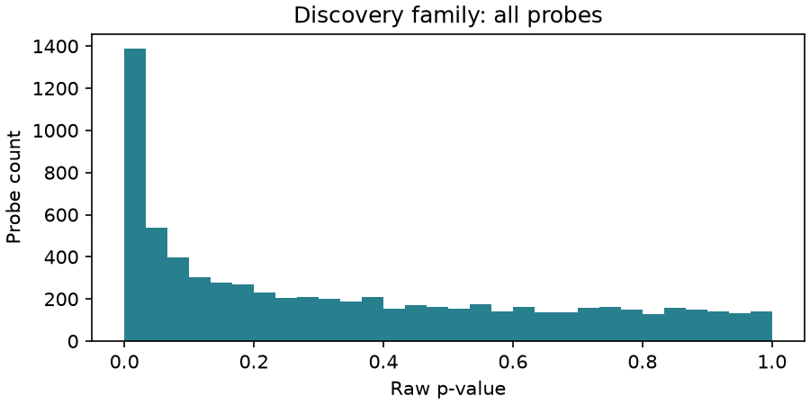

# HW06：多重检验校正实验报告

- 姓名：赵晨雨
- 学号：38720260158057
- GitHub 用户名：zhaochenyu666
- 完成日期：2026-11-26

## 一、初始预测与预定分析协议

- 1,000 个全零变量预计约产生 50 个原始显著结果，因为在真实零假设下，单次检验以约 0.05 的概率得到 \(p\le0.05\)，所以期望为 \(1000\times0.05=50\)。
- 53 个原始显著结果不能直接称为 53 个疾病相关基因；该数字本身没有区分假发现，也没有考虑效应大小、家族大小或验证证据。
- 真实数据研究问题与组别：比较 Golub 白血病数据中 AML 与 ALL 的平均探针表达，不含健康对照。
- 单个探针 H0、检验方向：H0 为 AML 与 ALL 的总体均值相等；双侧 Welch t 检验，差值方向固定为 AML−ALL。
- 发现部分：train；ALL 27 人、AML 11 人。
- 家族：全部 7,129 个探针列，每列一次检验；排除 `sample_id`、`diagnosis` 和 `original_split` 三个说明字段。家族大小 \(m=7129\)。
- 阈值与校正：统一阈值 0.05；比较 raw、Bonferroni、BH adjusted p≤0.05。
- 数据尺度：保留处理后的原表达尺度，不取 log，不把零或负数当作缺失，不写成 fold change。
- 候选锁定：发现部分中 BH 显著者按 raw p 升序、probe 名升序取前 10 个；不足 10 取全部。候选及发现方向在查看 test 前保存。
- 验证：test 中 ALL 20 人、AML 14 人。候选家族内计算 Bonferroni adjusted p≤0.05，并要求验证效应方向与发现方向相同；候选文件和验证判据在查看 test 前锁定。

## 二、A/B 模拟实验关键记录

- 来源：实际运行 Notebook，RUN_ID 为 `session-01`。
- 设置：种子 42，重复 1,000 次，变量数 1,000，两组分别 27 与 11 个观测；全零和有信号情境均使用标准差 1；有信号情境前 100 个变量分别加 δ=1.0 或 δ=0.5。

| A：全零情境 | 第一次 R | 平均 R | R 的标准差 | R 的 5%–95% 区间 | FWER 估计 | FDR 估计 |
|---|---:|---:|---:|---|---:|---:|
| raw | 42 | 49.944 | 6.762 | 39–61 | 1.000 | 1.000 |
| Bonferroni | 0 | 0.051 | 0.220 | 0–1 | 0.051 | 0.051 |
| BH | 0 | 0.052 | 0.227 | 0–1 | 0.051 | 0.051 |

| B：δ | 方法 | 平均 R | 平均 V | FWER 估计 | FDR 估计 | 平均 power |
|---|---|---:|---:|---:|---:|---:|
| 1.0 | raw | 122.523 | 44.799 | 1.000 | 0.364342 | 0.77724 |
| 1.0 | Bonferroni | 6.001 | 0.044 | 0.044 | 0.007487 | 0.05957 |
| 1.0 | BH | 30.094 | 1.445 | 0.754 | 0.046077 | 0.28649 |
| 0.5 | raw | 72.361 | 44.799 | 1.000 | 0.618728 | 0.27562 |
| 0.5 | Bonferroni | 0.270 | 0.044 | 0.044 | 0.039333 | 0.00226 |
| 0.5 | BH | 0.407 | 0.072 | 0.070 | 0.045267 | 0.00335 |

- 全零时 power 记为 N/A，因为没有真实信号，分母中 100 个真信号不存在。
- 一次未发现不代表方法永不出错；一次 FDP 为 0 与长期 FWER/FDR 是不同的重复概率与期望量。
- 控制取舍：δ=1.0 时 BH 平均发现 30.094 个、FDR 0.046077，而 Bonferroni 平均发现仅 6.001 个、FDR 0.007487；BH 通常更有检出力，Bonferroni 更保守。
- 弱信号未显著不能解释为没有真实差异；δ=0.5 时 BH 平均检出力仅 0.00335，说明漏检仍可能很多。

## 三、C1：完整家族比较

- 家族 \(m=7129\)。
- Bonferroni 对应原始 p 阈值：\(0.05/7129=7.013606396409034\times10^{-6}\)。

| 方法，阈值均为 0.05 | 发现数 | 能支持什么 | 尚不能说明什么 |
|---|---:|---|---|
| raw | 1694 | 全家族中哪些原始 p 符合常规显著阈值 | 是否受多重检验影响、哪些是真发现 |
| Bonferroni | 26 | 更严格地控制所有检验中的至少一次假发现 | 错过的真实差异以及效应是否有临床意义 |
| BH | 535 | 在适当假设下控制发现比例的长期期望 | 每个特定探针是否为真、机制或因果关系 |

原始 p 值直方图：

- 数量不同是校正方法的控制目标和保守程度不同，不意味着至少一种算错；相同原始 p 可得到不同 adjusted p。
- 真实数据不知道哪些探针的零假设为真，因此无法直接填写真实 V、假发现数或真实检出力。

## 四、C2：错误筛选流程审阅

任选一个相同探针对照：

| 探针 | raw p | 完整家族 BH | 先选前 20 再校正的 BH |
|---|---:|---:|---:|
| U22376_cds2_s_at | 8.388714620330695×10^-9 | 5.980314652833752×10^-5 | 1.677742924066139×10^-7 |

- 先看数据选前 20，再只校正这 20 项，会把筛选机会排除在家族之外；完整家族原本是 7,129 项，后者不能宣称仍控制原家族的 FDR/FWER。
- 如果 20 个探针在查看任何发现数据前就由独立生物学依据预先指定，那么该家族确实是预先固定的 20 项；但仍不能声称对未经指定的另外 7,109 项进行了校正。

## 五、C3：候选锁定与效应证据

- 候选数：10。
- RUN_ID：`session-01`。
- 锁定时间：2026-11-26 10:51:03（系统本地时区）。
- 原锁定文件：`.tmp/multiple-test/student-results/session-01/locked-candidates.csv`
- 正式附件：`locked-candidates.csv`（未编辑）。
- 查看 C4 前的初步判断：候选具有发现部分明显负或正的 AML−ALL 均值差，但仍需核验留出方向和候选家族校正。

选择第一个候选：

| 项目 | 发现部分结果 |
|---|---|
| 探针名 | U22376_cds2_s_at |
| n_AML / n_ALL | 11 / 27 |
| mean_AML / mean_ALL | 702.363636 / 3863.296296 |
| 均值差 AML−ALL | -3160.932660 |
| 逐项 95% CI | [-3977.848573, -2344.016747] |
| 描述性 Cohen d | -1.848424 |
| raw p | 8.388714620330695×10^-9 |
| Bonferroni adjusted p | 5.980314652833752×10^-5 |
| BH adjusted p | 5.980314652833752×10^-5 |

- 均值差为负表示 train 中 AML 平均表达低于 ALL，正值则相反；这里是原表达尺度的算术均值差，不能称为 fold change。
- 逐项 95% CI 不提供整个家族的同时覆盖率，也未对候选筛选带来的选择偏倚校正。

## 六、C4：留出验证

- 在 C3 完成候选锁定、发现方向保存和验证判据固定后才查看 test；本次运行没有此前接触相关 test 结果。
- 验证家族大小：10；候选内 Bonferroni 校正，阈值 0.05，剩余判据为验证方向与发现方向一致。
- 同时满足校正显著和同方向：10 个候选中的 7 个。`replicated` 汇总为 7 个；在这份历史留出数据中，候选内 Bonferroni≤0.05 且方向相同。

对同一候选：

| 项目 | 留出验证结果 |
|---|---|
| n_AML / n_ALL | 14 / 20 |
| 均值差 AML−ALL | -1766.728571 |
| 候选家族 Bonferroni adjusted p | 0.023186037773943062 |
| 与发现方向是否一致 | 是 |
| 是否满足预定验证判据 | 是 |

- 未满足验证判据不能证明没有差异，可能有效应较弱、样本较小、测量噪声或筛选偏倚。
- 最改变初始判断的证据是 test 中方向一致且候选家族 Bonferroni 显著，说明候选不是只在 train 中偶然出现；但它仍不能证明机制或临床价值。
- **主张—证据—推理—边界：** 主张：U22376_cds2_s_at 值得验证。证据：发现差值为 -3160.93，留出差值仍为负，候选 Bonferroni p 为 0.0232，方向一致。推理：支持 AML 与 ALL 存在表达差异。边界：test 非独立队列，不能证明机制、因果或临床价值，需独立验证。

## 七、概念与方法短答

| 概念 | 用自己的话定义 | 一个组学/临床例子 | 一个错误解释及纠正 |
|---|---|---|---|
| p-value | 在指定零假设和模型下，获得至少当前不一致结果的长期概率；不是零假设概率 | 某探针在两白血病亚型间的 Welch 检验 p=0.001 | 错误：p=0.001 意味为真概率 99.9%；纠正：它是在假设 H0 为真的前提下得到此样本统计量的尾部概率 |
| adjusted p-value | 将原始 p 或拒绝阈值按预先或依赖数据的校正程序调整，以对应家族和控制目标 | 7,129 个探针中某项 BH adjusted p=0.01 | 错误：BH adjusted p 是该探针为假的概率；纠正：它是在所设定 BH 程序下的校正显著性量，通常用于比较与阈值判定 |
| FDR | 多次重复实验中每次假发现比例 FDP 的期望值，控制的是长期平均，不是一次实验的每项概率 | 探索性筛选数千临床变量时 BH<0.05 | 错误：一次实验中假发现恰好只有 5%；纠正：某次 FDP 可以是 0、较高或较低，FDR 是重复上的期望 |

- FWER 是重复实验中至少出现一次假发现的概率；FDP 是一次实验中假发现数 \(V\) 除以全部发现数 \(R\)（没有发现记 0）；FDR 是多次实验的 FDP 均值。
- \(R\) 为总发现数，\(V\) 为假发现数，\(S\) 为真发现数。
- FDR 应逐次计算 FDP 再平均，因为 FDP 是每次实验的随机比例；平均 \(V\)/平均 \(R\) 会混合不同实验的分母，不能作为定义或无偏估计替代逐次平均。
- 1,000 次全零检验中，每次可能有约 50 个原始显著结果，原因是所有零假设都为真且每项约有 0.05 的假阳性概率；期望约 50 不要求检验相互独立，即使相关性会改变方差和实际分布。
- BH adjusted p 是对同一组原始 p 的逐步校正；Storey q-value 还会估计真实零假设比例。两者都不是探针单项为假的概率，也不能替代效应大小。
- 探索性组学筛选例子：筛选数千表达探针寻找待验证靶点，可优先控制 FDR/BH，以换取可接受漏检代价的候选列表。
- 确认性临床终点例子：主要安全或疗效终点决策代价很高，可优先控制 FWER/Bonferroni，并预注册少量终点，以牺牲检出力换取更少错误宣称。
- 校正后仍需效应、CI、生物学证据和独立验证，因为 p 值和 adjusted p 不说明效应大小、方向、测量可靠性或机制；筛选后的 CI 和不同观测层面的相关性也未自然解决。
- 多重校正不能自动证明因果、机制、临床有效性或独立验证，也不能证明一个单项 BH 显著探针一定是真发现。

可选手算示例：

- p 值按 0.001、0.009、0.020、0.040、0.200 排序；Bonferroni adjusted p 分别为 0.005、0.045、0.100、0.200、1.000，因此前四项显著，第五项不显著。
- BH 阈值依次为 0.010、0.020、0.030、0.040、0.050；前四项满足，最大满足位置 \(k=4\)，拒绝前四项。
- 两者都拒绝前四项时集合相同；若加入更弱 p 值，Bonferroni 通常更保守。

## 八、运行与 AI 使用记录

- Python 3.14.7；NumPy 2.5.5；pandas 2.3.3；SciPy 1.18.1；matplotlib 3.11.2；实际运行环境见 `versions.json`。
- 数据文件：`assignments/hw06/resources/data/leukemia.csv`。与本仓库说明中记录的 CRLF 版本哈希一致，SHA-256 为 `915bce00295ac470f6bd970a4032730a170a080642a5da53ab0bcb0545156f19`；未修改源数据。
- 软件及参数未修改：运行固定 seed 42、重复 1,000 次、`RUN_ID=session-01`，严格沿用 Notebook 协议和候选规则。
- 未发现与课堂记录冲突；本次数值来自实际运行输出。
- AI 是否参与：是。AI 参与运行命令、核对模板；本人核查了源数据哈希、候选锁定、发现/留出方向、报告数值和提交范围。

## 九、提交前自查

- [√] 协议、A/B 关键记录与 C1–C4 已完成；
- [√] 结果来自实际运行输出；
- [√] 候选在查看 C4 前锁定，正式名单副本未改动；
- [√] 报告保留一个候选的效应、CI、校正结果和验证证据；
- [√] 已说明 test 非外部独立验证；
- [ ] 尚未提交或推送；仅准备正式报告、图与候选名单。
